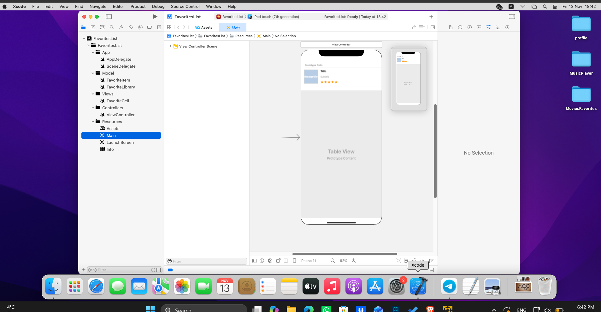
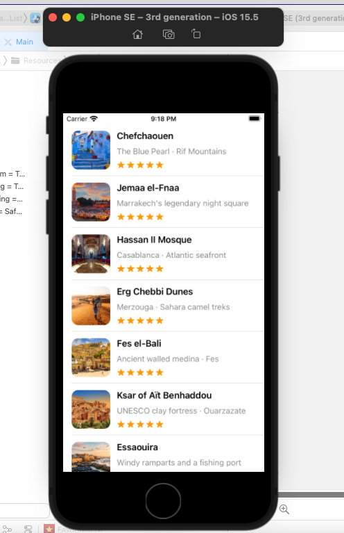
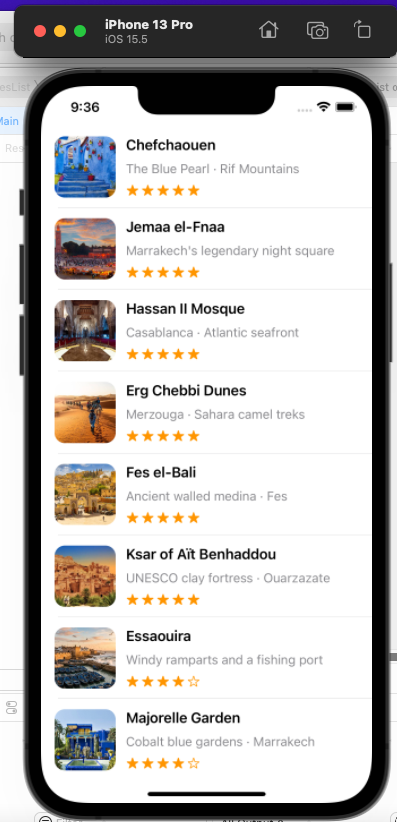

# Favorites List — Morocco

UIKit app for the lab "Favorites List — UITableView & Custom Cells".
Theme: 20 favorite places in Morocco, each with a title, a subtitle, an image and a 0–5 rating drawn with SF Symbols (`star.fill` / `star`).

## Run

1. Open `FavoritesList.xcodeproj` in Xcode.
2. Pick an iPhone simulator (iPhone SE (3rd generation) or iPhone 16 Pro Max).
3. Press Run. No extra setup, no packages, no signing needed for the simulator.

## Screenshots
| Work in Progress Screenshot
| 

| iPhone SE (3rd gen) | iPhone 13 Pro (16 not available in my VM)|
| --- | --- |
|  |  |

## Structure

```
FavoritesList/
├── App/            AppDelegate, SceneDelegate
├── Model/          FavoriteItem (struct), FavoriteLibrary (the 20 items, in one place)
├── Views/          FavoriteCell (UITableViewCell subclass: outlets + configure(with:))
├── Controllers/    ViewController (UITableViewDataSource)
└── Resources/      Main.storyboard, LaunchScreen.storyboard, Assets.xcassets, Info.plist
```

## How it matches the lab

- **Data**: `FavoriteItem` struct, array lives in `FavoriteLibrary.items`. 20 items, each with its own image set in `Assets.xcassets`.
- **Custom cell**: `FavoriteCell` in its own file. Only `@IBOutlet`s and `configure(with:)`. No layout code.
- **Table view**: one `UITableView` pinned to the Safe Area in `Main.storyboard`. The cell is a prototype cell (class `FavoriteCell`, reuse identifier `FavoriteCell`). The controller is the data source and uses `dequeueReusableCell(withIdentifier:for:)`.
- **Layout**: all Auto Layout is in the storyboard. Image (72×72) on the left, a vertical stack view on the right (title, subtitle, horizontal stack of 5 SF Symbol image views). Titles and subtitles wrap on 2 lines, so long ones don't touch the image or leave the screen. Cell height is automatic.
- **Reuse**: `configure(with:)` sets every field and every star each time a cell is dequeued, so reused cells never keep old data.

## Changing the images

Each place has an image set in `Assets.xcassets` named like its `imageName` in `FavoriteLibrary.swift` (`chefchaouen`, `jemaa`, ...). To use real photos, drag a new image onto the image set with the same name.
