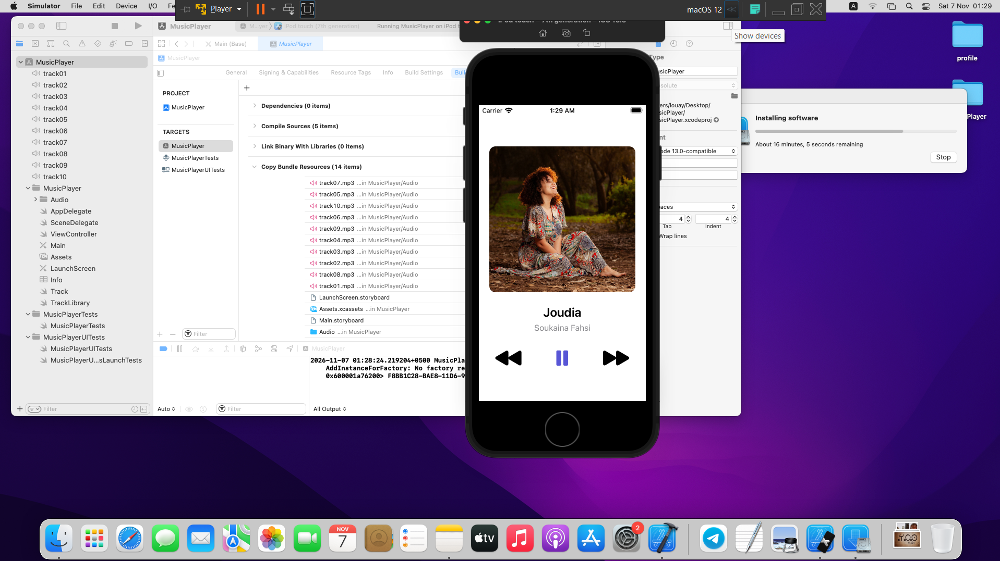
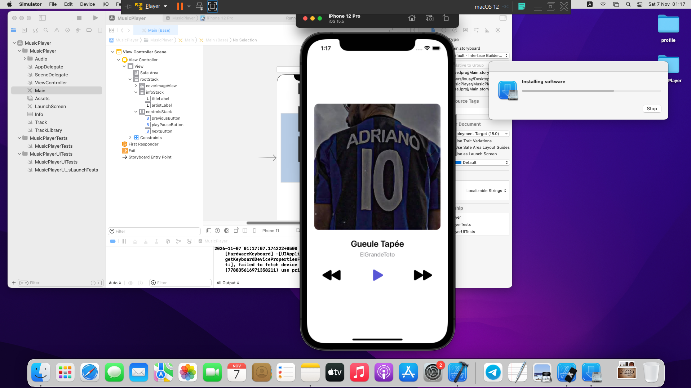

# Music Player — UIKit

A single-screen music player built with UIKit, Storyboard, UIStackView, Auto Layout, and AVAudioPlayer.

## Features

- Displays album artwork, track title, and artist.
- Play and pause audio playback.
- Navigate to the previous and next tracks.
- Automatically plays the next track when the current one finishes.
- Supports circular navigation through the track list.
- Handles missing audio resources without crashing.
- Adaptive layout for different iPhone screen sizes.

## Technologies

- Swift
- UIKit
- Storyboard / Interface Builder
- UIStackView
- Auto Layout
- AVFoundation
- AVAudioPlayer

## Project Structure

- `ViewController.swift` — UI updates and playback logic.
- `Track.swift` — Track data model.
- `TrackLibrary.swift` — Central track collection.
- `Main.storyboard` — User interface and layout.
- `Assets.xcassets` — Track cover images.
- `Audio/` — Bundled MP3 files.

## Screenshots

### iPhone SE (3rd generation)

### iPhone 12 Pro

(I am using a VM on windows so I can't use iphone 16 pro since my xocde has an older version)

## Demonstration

[Watch the Music Player demonstration](MusicPlayer-Demo.mov)

## Audio Credits

Audio files are royalty-free tracks. Individual sources and licence information should be credited here.

## How to Run

1. Clone the repository.
2. Open `MusicPlayer.xcodeproj` in Xcode.
3. Select an iPhone simulator.
4. Build and run the project.

No additional setup is required.
