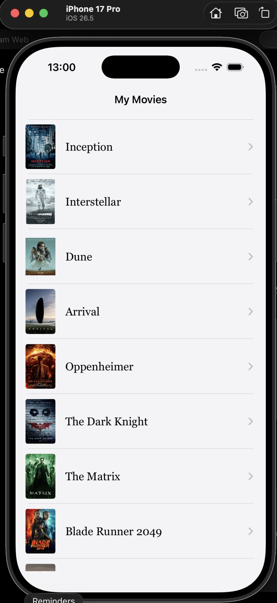
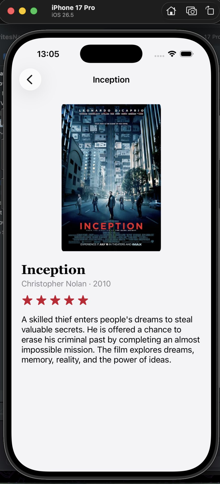
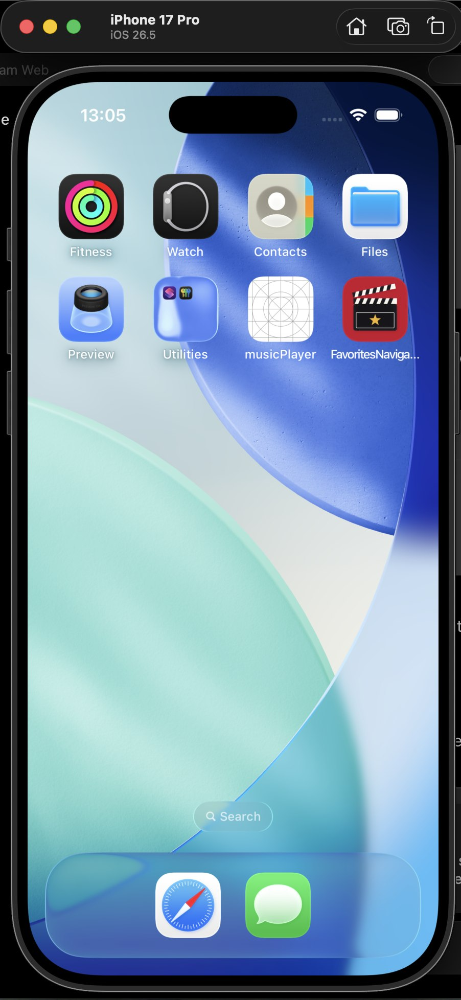

# Favorites Navigator

**Name:** Louay Ziani
**Course:** iOS Mobile Development, Lab "Favorites Navigator: UINavigationController & Detail Screen"
**Theme:** Movies

## About the app

A small UIKit app with a list of 20 movies I like, from Inception and Interstellar to Parasite and The Shawshank Redemption. The list sits inside a `UINavigationController` with a large title ("My Movies"). Each row shows only the poster and the title. Tapping a row opens a detail screen with the large poster, title, director and year, the rating as SF Symbols stars, and a description.

Everything visual is built in `Main.storyboard`: the navigation controller, both screens, the Show segue (`showDetail`) and all Auto Layout. The Swift code only holds the data, the table view data source, `prepare(for:sender:)` and fills the outlets.

## How it works

- `FavoriteItem` is the data model (title, subtitle, image name, rating, description) and `FavoriteLibrary.swift` keeps all 20 items in one place.
- `ListViewController` is the table view data source, deselects the tapped row in `viewWillAppear` and passes the selected item to the detail screen in `prepare(for:sender:)`.
- `FavoriteCell` is the prototype cell (poster + title), dequeued with the reuse identifier `FavoriteCell`.
- `DetailViewController` has one `item` property and fills its own outlets in `viewDidLoad`. The content is in a scroll view, so the description never goes off screen on small iPhones.
- Every movie has its own poster in `Assets.xcassets` (`Poster01` to `Poster20`).
- App icon is a single 1024×1024 PNG (no transparency, no rounded corners). The launch screen shows the icon art centered on the app background color and supports Dark Mode.

## Screenshots

| List | Detail |
|---|---|
|  |  |

| Launch Screen | App Icon on Home Screen |
|---|---|
|  |  |

## Run it

Open `FavoritesNavigator.xcodeproj` in Xcode and run on any iPhone simulator (iOS 16+).
